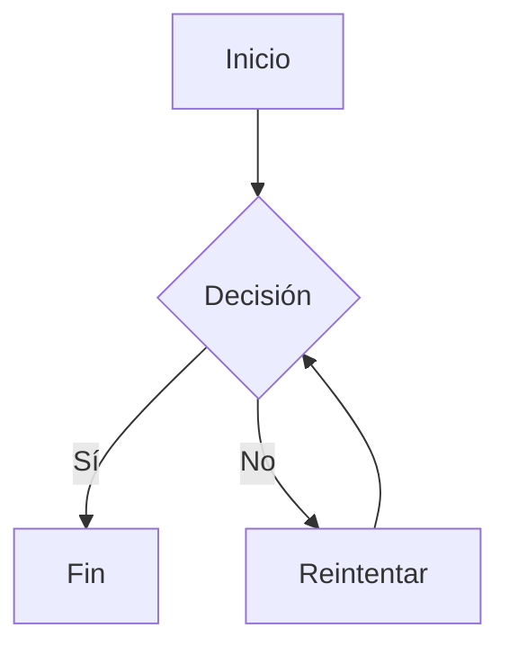
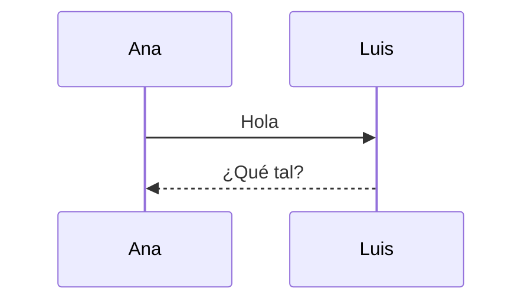

# Manual de ejemplo :rocket:

Texto con **negrita**, *cursiva*, `código` y un [enlace](https://ejemplo.org).

> [!WARNING]
> Esto es una advertencia.

## Lista y tareas

- Uno
  - Anidado
- [x] Hecho
- [ ] Pendiente

| Nombre | Valor |
|:-------|------:|
| Alfa   | 10    |
| Beta   | 20    |

```python
def hola():
    return "mundo"  # saludo
```






